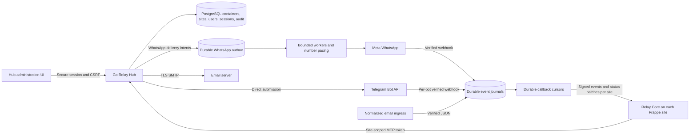

# Relay Hub architecture

Relay Hub is the Go transport boundary. Relay Core is a Frappe app installed alongside business apps and uses Frappe authentication. Hub's separate administrator login manages containers, sites, users and tokens; it is not a replacement Core login.

## Ownership and identity

A container groups provider apps and their channels: for example one Meta app with several WhatsApp numbers in several WABAs, and some Telegram bots and mailboxes. A site is one Core site. Each channel belongs to one site, or to no site. Many sites can share one container. See [configuration](configuration.md#containers-sites-and-channels).

Provider credentials stay in the Hub. An API token belongs to one site and can call every tool for that site. The token can use only the channels of its site. Core resolves Contacts, business records, teams, user permissions, conversation bindings and AI actions. The Hub does not check business-record permissions; Core does, with Frappe DocType permissions.

PostgreSQL stores sequential numeric identities for high-volume journals and queue rows. Provider message IDs, Telegram chat/topic IDs and caller request keys are separate fields. Group conversations remain separate from participant DMs; quoted replies retain the original provider message ID. See the [database model](database-authentication-model.md) and [API reference](api-reference.md).

## Routing between sites

Inbound: one WhatsApp webhook address serves a container. The Hub checks the signature with the container app secret, then finds the number by its phone number ID and journals the event with the number's site. Template status changes come per WABA; the Hub marks the WABA's templates as old and fetches them again only when a number of that WABA syncs. Telegram and email events take the site of their bot or mailbox. An event of a channel without a site is stored and answered with success, but no site gets it until an administrator replays it.

Callbacks: each batch goes to one site. The top-level `account` field is the site ID and `channel_key` is the channel. Each event, status and bulk update also has `channel_key` and `to` (the number, bot username or mailbox address that received it), so Core can reply from the same channel. Each channel has its own callback cursor, so a slow site does not hold back another site. A site also gets a `relay_channels` event when its channel list changes.

Outbound: a send takes the channel from its `channel` argument, or the only channel of that type that the site has. A channel of another site is refused. A send keeps its site after it is queued. Pricing of a WABA that another site shares needs the `PHONE` dimension; the Hub returns only the site's own numbers and adds `channel_key` to each row.

## Send and receive guarantees

WhatsApp's durable outbox admits bounded batches of up to 50 intents with stable-key deduplication. Workers claim work through PostgreSQL and obey the pacing of each number. A queued result means accepted locally, while submitted means the provider returned an accepted result; neither proves delivery or reading.

A lost provider response can leave an intent uncertain. The Hub does not blindly replay that mutation. Stored status events can reconcile receipts without resending. Direct WhatsApp execution, Telegram message operations and SMTP sending do not inherit the WhatsApp queue's admission/deduplication guarantees.

Verified inbound payloads are journaled before acknowledgement. After the journal, a verified request can also be copied to other URLs in the background; see [webhook forwarding](configuration.md#webhook-forwarding). Callback cursors advance after Core acknowledges durable processing. WhatsApp separates realtime and batched-status lanes; Telegram/email use the channel-event callback path. Raw payloads remain available for provenance and typed projection. Reactions, edited messages and membership events are not equivalent to new conversational text.

## Bounded resources

The launcher defaults to limited Go/build concurrency. WhatsApp adapts worker count between one and the configured ceiling, up to eight; this is process worker scaling, not automatic deployment scaling. PostgreSQL coordinates the send pacing of each number across workers.

Queries, batches, provider bodies, photo dimensions and sticker downloads have explicit bounds. Frontend lists use [bounded rendering](frappe-virtualization.md) and server pagination. Capacity depends on provider latency, database limits and workload; simulations do not promise a production throughput figure.

## Credentials and media

Runtime registry replacement publishes validated snapshots so later requests see rotated or disabled channel credentials. An already in-flight request can complete against the older snapshot. Browser sessions and Hub API tokens are PostgreSQL-backed and revocable.

The main channel secret is encrypted. Some generic configuration fields that contain secrets are not; the [configuration reference](configuration.md#current-administration-limits) records that production gap and the current grant-list limitation.

Sticker retrieval requires an inbound record of one of the site's channels and uses bounded, constrained provider downloads. Hub returns bytes and MIME metadata to Core, which checks message visibility before serving the browser. This is not a general private media store, attachment archive or call-recording service.

## Current boundaries

See the [provider support matrix](provider-support.md) for the exact implemented surface. General Telegram media/edit/delete APIs, full email mailbox/MIME handling, hourly provider reconciliation, server call recording and replica autoscaling are not supplied by this implementation. Live account eligibility and provider delivery remain a separate acceptance step after [local simulation](testing.md).

### Bounded channel callback replay

Telegram/email production callbacks and explicit replay now share one encoder
and acknowledgement path. The source query selects at most 50 rows and applies
an aggregate source-byte bound; final JSON encoding still enforces the callback
body limit (2 MiB minus 4 KiB headroom). The first source row is always returned
so an oversized event produces an explicit failure rather than disappearing
behind a size filter. Failed callbacks retain their cursor. This does not yet
provide poison-event quarantine or separate compact status lanes for these
channels.

Validation: isolated PostgreSQL with Go race checks for `internal/channels` and
`internal/hubmcp` passed. Coverage includes recovery/account isolation, two
800 kB events followed by a one-event batch, and an oversized first event that
is neither transmitted nor skipped. Provider calls use local simulators. This
change is local and has not yet replaced the running Hub binary.

### Channel callback quarantine (local, not deployed)

Migration 0027 records an oversized Telegram/email callback by original event
ID, account, channel and reason. Production dispatch commits that record and
cursor movement in one transaction. It does not alter or delete the journaled
payload. A malformed, unauthenticated or unavailable Core response still
retries without advancing; only a locally proven oversized event qualifies.
Explicit replay returns the size failure and does not itself skip events.

The admin-only `/api/callback-failures` endpoint lists 50 failures per page with
account/channel filters and keyset pagination. Hub Channels exposes this list
for Telegram and email. Original event inspection also includes the quarantine
reason. The isolated PostgreSQL/race test proves original-data retention and
later-event delivery after quarantine. Operator recovery/replay controls and
installed browser/API authorization acceptance remain unfinished; this change
must remain local until those checks are complete.

Callback recovery now implemented locally: an admin-only CSRF/origin-protected
POST retries exactly the selected quarantined event under the channel advisory
lock. Runtime account credentials are resolved server-side. Successful Core
acknowledgement sets `resolved_at`; failure keeps quarantine active. Production
cursors do not rewind. Failure history and original payload remain retained.
The Channels failure list exposes Retry callback with an explicit underlying
issue warning; retries do not magically reduce an oversized payload.

Isolated database/race checks pass for successful single-event retry, rejected
oversized retry, cross-channel rejection, failed acknowledgement retaining
quarantine, and already-resolved rejection. HTTP unit tests cover non-admin,
origin, CSRF, unexpected fields, channel validation and failure responses.
Installed deployment/browser acceptance remains outstanding.

Callback recovery deployed locally: migration 0027 applied successfully;
`relay-hub-callback-recovery` PID 2931375 passed readiness. The deployed UI files
were exercised through a temporary loopback static server with explicit API
fixtures (server stopped afterwards). Browser validation caught and fixed a
failed-retry row being hidden by its error; the rerun proves the row remains,
the retry uses the selected account/channel/event, and successful recovery
refreshes the list. No real callback was replayed. The live unauthenticated
failure-list request redirects to login (303). An existing 18126 browser tab
was a separate test preview, not an authenticated session on this runtime;
live authenticated admin API/browser acceptance remains unproven.

## Message event inspection (24 September 2026)

The Events screen defaults to provider messages; system authentication activity
is a separate tab. The admin-only `/api/event-inspector` endpoint requires an
account and channel, lists 50 summaries per keyset page, and loads payloads only
on selection. SQL limits summaries to 240 characters and payload previews to
65,536 characters. The complete source remains in the database. Forwarded
means Core acknowledged receipt, not that a customer read a message.

The local event-inspector release is deployed and `/readyz` passed. Isolated
PostgreSQL tests cover account/channel isolation, bounded reads, cursor paging,
quarantine visibility and partially forwarded WhatsApp batches. Browser fixture
checks cover payload escaping, pagination, scope reset and desktop/mobile
layouts in light/dark themes. Live authenticated Hub browser acceptance remains
separate from these fixture checks.
