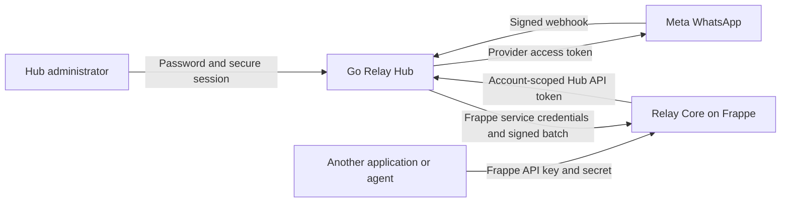

# Relay Hub authentication

Hub owns users and API credentials. Core owns business-record permissions. The browser's Hub session, Core's Hub API token, Frappe's API key/secret, Meta's access token, Meta's webhook verification token, and Meta's webhook signing secret are separate credentials.

## Setup

Apply migrations with `./relay migrate`. Configure `RELAY_PUBLIC_ORIGIN` to the exact HTTPS origin in private `.env`. Set `RELAY_PUBLIC_PREFIX=/hub` only when mounted through the review gateway; otherwise leave it empty. The TLS reverse proxy must preserve Host and strip the configured mount prefix. Hub still listens on loopback. It trusts no forwarded authentication or identity headers.

Follow the [quickstart](quickstart.md) for private configuration and a secure bootstrap example. Standalone Go commands require a concrete `DATABASE_URL`. Run `go run ./cmd/relay-hub bootstrap-user` with two stdin lines: username then password. Use a private input file or secure subprocess input; do not place passwords in command-line arguments. Bootstrap is disabled once any user exists. No default login is installed.

Sign in at `/auth/login`. Administrators create users, reset passwords, disable users and grant/remove configured account access. The final active administrator cannot be disabled. Members may manage their own password, sessions and tokens; an account grant conveys authority over that account. Token permissions can narrow that authority. The Accounts UI saves database-backed channel configuration and offers runtime reload. The current grant-list and credential-field limitations are documented in [configuration](configuration.md#current-administration-limits). No token can be created without an account grant.

`/auth/tokens` creates a named, account-scoped token with no expiry (manually revoked), or an optional expiry of 1–90 days. The token is shown once. Store it in Core's private site configuration (`relay_hub_token`), with `relay_hub_url` pointing to the Hub MCP endpoint. Include `account:read` for Core's site-binding check, plus permissions required by the operations. Grant `messages:send` for single/bulk delivery. Do not use an administrator browser cookie for API access.

The running server accepts only database-backed per-user tokens. Legacy `RELAY_MCP_TOKEN` and registry `core_token` values are no longer accepted by `serve`. Compatibility constructors exist only for legacy unit fixtures. Existing integrations must provision a user token before switching servers.

## Security behavior

- Sequential numeric user, token, session and audit IDs; random secrets remain necessary for credentials.
- Passwords contain 14–200 bytes and use PBKDF2-HMAC-SHA256 with unique random salt and 600,000 iterations.
- 256-bit opaque session tokens; Secure, HttpOnly, SameSite cookies; database stores only hashes.
- Sessions persist until sign-out, explicit revocation, password/auth-version change, or account disablement. The secure HttpOnly browser cookie is renewed for 400 days on authenticated requests (subject to browser storage policies). Existing already-expired sessions are not revived. A maximum of 50 active sessions prevents unbounded accumulation; new logins at that limit are rejected rather than silently evicting another device. Temporary database errors return 503 without clearing a valid cookie.
- API tokens are random, stored only as hashes, account-bound, scope-checked and checked against current user/grant state on every request. API credentials never authenticate browser sessions and session cookies never authenticate MCP.
- Password changes revoke all browser sessions. In the self-service UI, integration API tokens stay active unless the user selects ‘Also revoke my API tokens’. Preserving tokens requires the correct current password. Administrator resets always revoke tokens, even if a caller asks to preserve them. Older API callers that omit the preference retain the previous revoke-all behavior. Disabling a user or removing a grant still blocks tokens immediately; re-enabling does not revive revoked tokens.
- Origin and CSRF checks protect browser mutations. Login throttling and password-hashing concurrency are bounded per process. Multi-replica rate limiting, MFA, recovery workflows and external security review remain deployment work.
- Security mutations are audited without credential values. No password or token hashes appear in list APIs/pages.
- Public review proxy exposes `/hub/` through Hub authentication and `/hub/mcp` through token authentication; it blocks direct operational probe paths. WhatsApp callbacks retain their own verification and HMAC authentication. Core's preview remains separately protected and uses sample data.

## Hub MCP contract

Stateless JSON MCP protocol `2025-06-18`, endpoint `/mcp` (public review mount `/hub/mcp`). Use `Authorization: Bearer <Hub API token>` and `Accept: application/json, text/event-stream`. This is provisioned first-party token authentication, not an OAuth discovery/authorization server.

The [MCP reference](api-reference.md) is the canonical tool, scope and payload list, including typed Telegram messages, reactions, group operations and authenticated sticker retrieval. Queue acceptance, direct submission and provider delivery are different outcomes; use the reference for retry and receipt semantics.

## Validation and limits

PostgreSQL-backed race tests verify bootstrap locking, user roles, last-admin protection, grant isolation, token hashing/scopes/expiry, password revocation, disabling users, session expiry, CSRF and browser cookies. MCP tests verify account isolation, scope denial and credential rejection. Public-browser checks verify Hub login, Users, Tokens, Sessions and Password pages on mobile. Core simulations also exercise real isolated Frappe permissions and PostgreSQL with loopback provider fixtures; live-provider acceptance remains separate. See [group simulation coverage](group-simulation-coverage.md) for group-specific evidence and limits.

Telegram webhook registration uses a per-account secret derived from the private
`RELAY_TELEGRAM_WEBHOOK_SECRET` master. Hub administrators retrieve the derived
secret and relative callback path from
`GET /api/accounts/{account}/telegram/webhook`; the response is non-cacheable and
never contains the master or bot API token. Set Telegram's `secret_token` to this
derived value. The old shared value is rejected, and rotating the master requires
registering each bot webhook again. Credential reloads atomically publish a new
channel registry to existing MCP and webhook handlers.

Meta uses its verification token for the GET subscription challenge and `X-Hub-Signature-256` plus the App Secret for POST authenticity. See the [official webhook reference](https://whatsapp.github.io/WhatsApp-Nodejs-SDK/api-reference/webhooks/start/).

Non-expiring Hub tokens do not change Meta/Telegram provider credentials. Existing finite token expirations are preserved. A `days=0` request explicitly selects no expiry; malformed/missing expiry input is rejected. Scopes, enabled-user checks, account grants and revocation are enforced in the database on use. Returned user metadata describes the authenticated session; it is not accepted as client authority.
