# Relay Hub user guide

This guide is for the owner and the administrators of a Relay Hub. It tells you where to go, what to add, and what happens after you add or change something. Read section 1 and section 2 first. Then use the page catalog and the recipes when you need them.

The screenshots come from a local test Hub. Numbers, IDs, keys and webhook addresses in them are hidden or replaced with placeholders such as `https://hub.example.com` and `<public-id>`.

## Contents

1. [What the Hub is](#1-what-the-hub-is)
2. [Words used in this guide](#2-words-used-in-this-guide)
3. [Who can do what](#3-who-can-do-what)
4. [Page catalog](#4-page-catalog)
5. [Recipes](#5-recipes)
6. [Status labels](#6-status-labels)
7. [What happens if…](#7-what-happens-if)
8. [Things the Hub pages cannot do yet](#8-things-the-hub-pages-cannot-do-yet)

## 1. What the Hub is

Relay Hub is the post office between the message providers and your business sites.

It receives every WhatsApp, Telegram and email message for your numbers, bots and mailboxes.

It keeps each message safe, then passes it to the one site that owns that number, bot or mailbox.

The site runs Relay Core. People read and answer the messages in the Relay Core inbox, not in the Hub.

When a person sends a reply in Core, Core gives it to the Hub, and the Hub sends it to the provider.

```text
  Meta (WhatsApp)     Telegram       Mail server
        |                 |               |
        v                 v               v
 +-------------------------------------------------+
 |                   RELAY HUB                     |
 |                                                 |
 |  Container "Essdee Main"                        |
 |    WhatsApp numbers   Telegram bots   Mailboxes |
 |          |                 |              |     |
 |          +------ linked to a site --------+     |
 |                        |                        |
 |  Site "yrp"  (one Relay Core install)           |
 +-------------------------------------------------+
                          |
                          v
            Relay Core on yrp  ->  Core inbox
                          |
     replies: Core -> Hub -> provider -> customer
```

Remember three rules:

- A container holds accounts. It does not decide where messages go.
- A link from an account to a site decides where messages go. One account goes to one site only.
- Nothing reaches Core until the account is linked to a site and the site has its Core connection.

## 2. Words used in this guide

| Word | Meaning |
| --- | --- |
| Hub | This service. It has its own sign-in, users and pages. |
| Core (Relay Core) | The Frappe app on your business site. It has the inbox, contacts, templates, billing and AI. |
| Container | A box for provider accounts. For WhatsApp it also holds one Meta app (App ID, app secret, verify token, optional system-user token). Many sites can share one container. |
| Account | One WhatsApp number, one Telegram bot or one mailbox. It lives in one container. |
| Channel | The provider type of an account: WhatsApp, Telegram or Email. |
| Channel key | The short internal name of an account, for example `sales`. The Hub makes it from the account name when you add the account. You do not type it. |
| Public webhook ID | The long random part at the end of a webhook address, for example `/webhooks/whatsapp/<public-id>`. The Hub makes it once. It never changes and it does not show your business name. |
| Webhook address (callback URL) | The address where a provider sends messages to the Hub. WhatsApp has one address per container. Each Telegram bot and each mailbox has its own address. |
| Verify token | A private word that you choose (or generate) and paste in Meta. Meta uses it one time to check the WhatsApp webhook address. |
| App secret | The secret of your Meta app. The Hub uses it to check that each WhatsApp message really comes from Meta. |
| Site | One Frappe site that runs Relay Core, for example `yrp`. |
| Site ID | The short name of a site in the Hub, for example `yrp`. You type it when you create the site. You cannot change it later. Core uses it as "Hub account". |
| Site link | The web address of the Core site, for example `https://yrp.example.com`. It must be the same address that the Core site uses for itself. |
| Core API key and Core API secret | A Frappe API key pair of a service user on the Core site. The Hub uses it to give messages to Core. You make it in Frappe and paste it in the Hub. |
| Callback secret | A shared secret of 32 or more characters. The Hub signs each message that it gives to Core with it. Core checks the signature. The same value must be in the Hub and in Core. |
| Auth key (API token) | A key that Core uses to call the Hub (to send messages, read templates and so on). You make it in the Hub and paste it in Core. One key works for one site only. |
| Forward target | Another web address that gets a copy of each checked webhook, for example an old system that must keep working. |
| Administrator | A Hub user who can see and change everything. |
| Member | A Hub user who can only make auth keys for the sites that an administrator gave to them, and manage their own password and sessions. |

## 3. Who can do what

| Task | Administrator | Member |
| --- | --- | --- |
| Open Overview, Containers, Sites, Connections, Deliveries and Events | Yes | No. These pages show an error for a member. |
| Add or change containers, accounts, sites, links and forward targets | Yes | No |
| Add users, reset passwords, disable users, give site access | Yes | No. The Users page is not in the menu for a member. |
| Make auth keys | For any site | Only for sites that an administrator gave to them |
| Change own password, sign out other sessions | Yes | Yes |

The Hub always keeps at least one active administrator. You cannot disable the last one.

## 4. Page catalog

The menu on the left has two parts. The top part is **Administration**: Overview, Containers, Sites, Connections, Deliveries and Events. The bottom part is about people and access: Users, Auth keys, Sessions and Password.

The top bar is the same on every page:

- **Ready** badge: green when the Hub can read its database. Orange or red means a problem. Open **Notifications** to read the last error.
- **Notifications**: shows the last error from the page, and the time of the last check.
- **Refresh**: reads the page again. Pages also update by themselves when something changes.
- The sun or screen icon changes the color theme.

### 4.1 Sign in

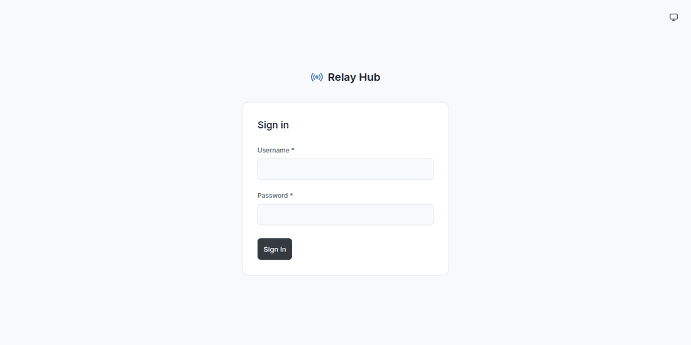

Open the Hub address in a browser, for example `https://hub.example.com`. Type your username and password and click **Sign in**.

The Hub sign-in works only on the HTTPS address of the Hub. It has no default user. The first administrator is made on the server (see [recipe 5.1](#51-first-setup-on-a-new-server)).

### 4.2 Overview

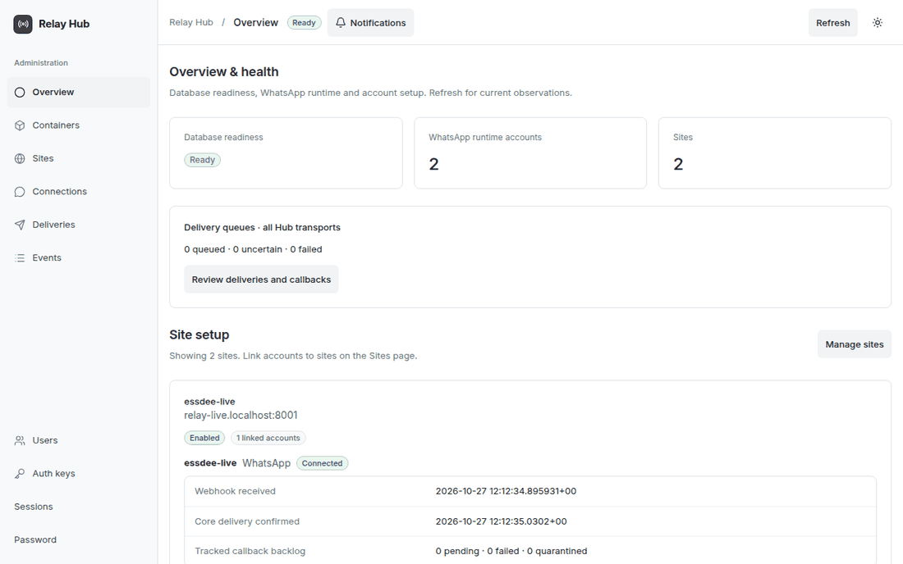

What it shows:

- **Database readiness**: Ready or not.
- **WhatsApp runtime accounts**: how many WhatsApp numbers the Hub runs now.
- **Sites**: how many sites the Hub has.
- **Delivery queues**: the count of sends that wait (queued), that need a check (uncertain) and that failed. **Review deliveries and callbacks** opens the Deliveries page.
- **Site setup**: one card per site, with its status, its linked accounts and their health. Health shows when the Hub last got a webhook, when Core last confirmed a message, and how many messages wait for Core.

Nothing on this page changes data. Use it as your daily check. If "Core delivery confirmed" is old while "Webhook received" is new, Core is not taking messages. See [recipe 5.10](#510-check-health-and-logs).

### 4.3 Containers

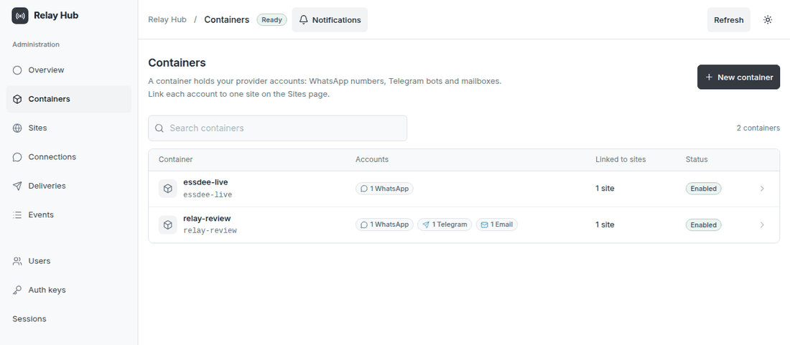

The list shows each container with its accounts (for example "1 WhatsApp"), the number of sites that its accounts are linked to, and Enabled or Disabled. Use the search box to find a container by name.

**New container** opens a dialog with one field, **Name**. After you click **Create container**, the Hub makes the container, gives it a random ID and a random WhatsApp webhook address, and opens it. The name never shows in a public address.

Click a container row to open it.

#### Container page, top

- **Rename** opens a dialog with **Name** and **Container enabled**.
- If you clear **Container enabled** and save, the Hub stops all accounts in this container at once. They do not receive or send until you enable it again. Saved settings stay.

The tabs **WhatsApp**, **Telegram** and **Email** show the accounts of each type. The number on a tab is the count of accounts.

#### WhatsApp tab

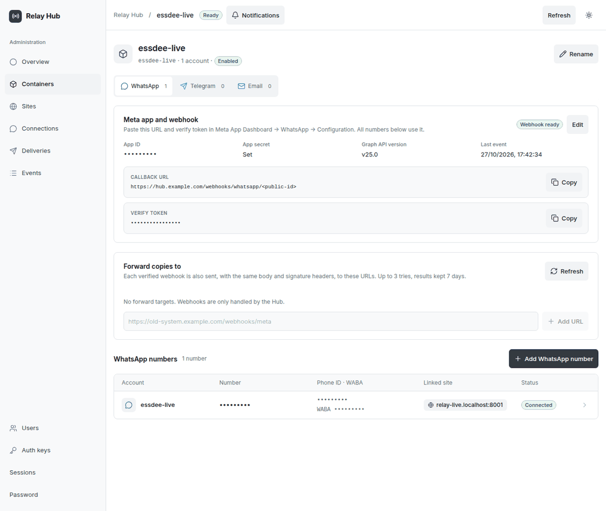

**Meta app and webhook** card:

- **App ID**, **App secret** (Set or Not set), **Graph API version**, **Last event** (the time of the last WhatsApp webhook).
- **Webhook ready** (green) means the app secret and the verify token are saved. **Setup needed** (orange) means one is missing.
- **Callback URL** with **Copy**: paste this in Meta. All numbers in this container use this one address.
- **Verify token** with **Copy**: paste this in Meta. The value is hidden on the page. **Copy** puts it on your clipboard.
- **Edit** opens the Meta app dialog.

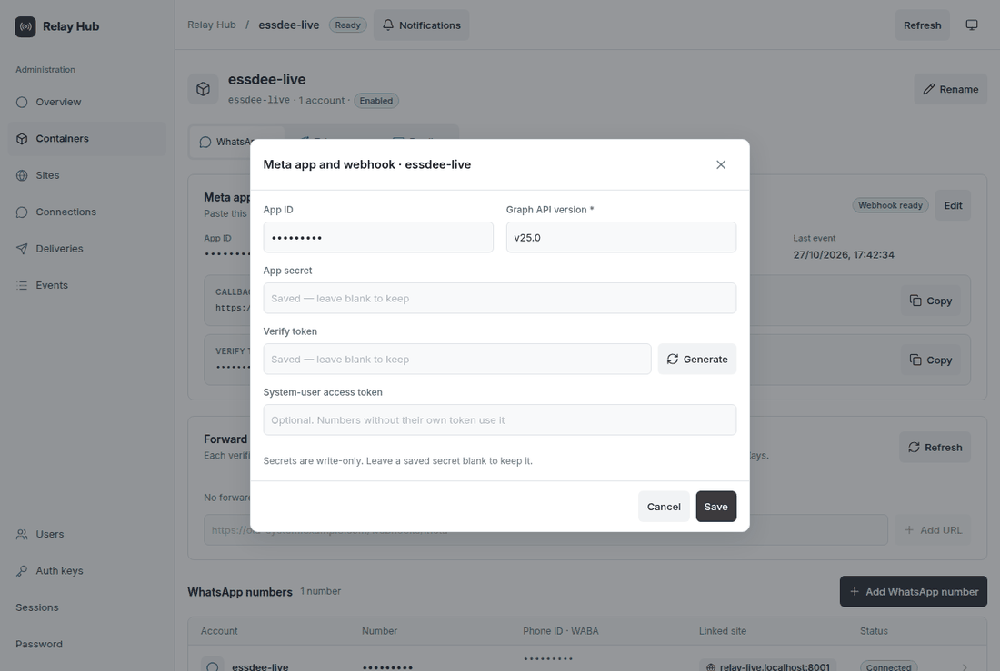

| Field | What to type | What happens after Save |
| --- | --- | --- |
| App ID | The numeric ID of your Meta app. | The Hub uses it for template media and checks. |
| Graph API version | For example `v23.0`. The form needs the format `v<number>.0`. | All numbers in the container call Meta with this version. |
| App secret | From Meta App Dashboard → App settings → Basic. Required the first time. | The Hub checks every incoming WhatsApp message with it. A wrong value makes the Hub refuse all WhatsApp messages of this container. |
| Verify token | Type a private value, or click **Generate**. Required the first time. | Meta needs the same value when you verify the callback URL in Meta. |
| System-user access token | Optional. A Meta system-user token. | Numbers in this container that have no own token use this one to send. |

Secrets are write-only. The page never shows them again. Leave a saved secret blank to keep it.

**Forward copies to** card: see [recipe 5.6](#56-add-a-forward-target). On the WhatsApp tab it serves the whole container.

**WhatsApp numbers** list: each row shows the account name, the display number, the Phone number ID and WABA ID, the linked site and the status. **Not linked to a site** means that its messages stay in the Hub and do not go to Core. Click a row to edit the number.

**Add WhatsApp number** opens this dialog:

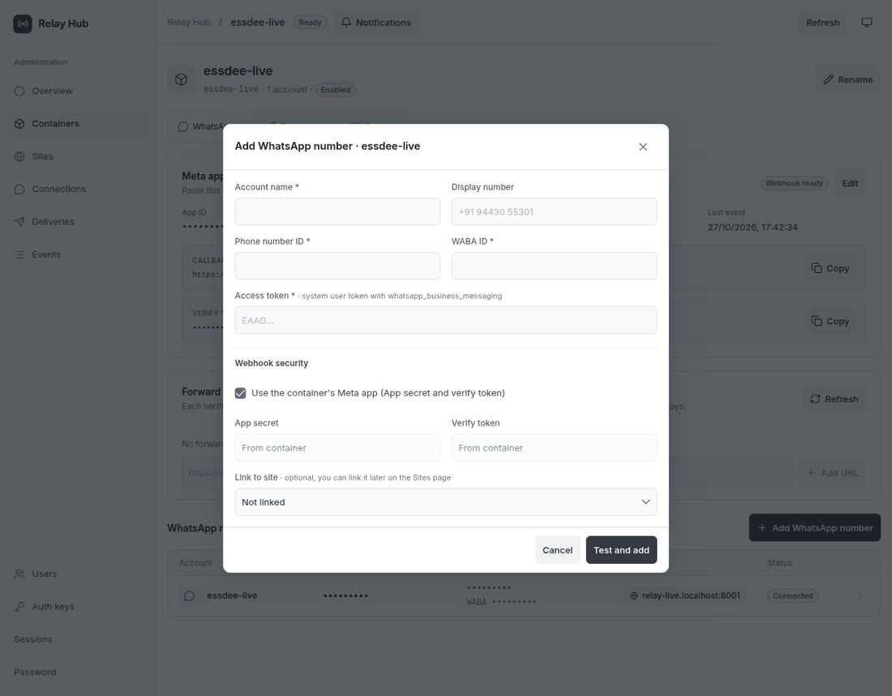

| Field | What to type |
| --- | --- |
| Account name | A name that people know, for example "Sales". The Hub makes the channel key from it. |
| Display number | Optional. The phone number as people see it. |
| Phone number ID | The numeric ID from Meta (WhatsApp → API Setup). Required. |
| WABA ID | The numeric WhatsApp Business Account ID from Meta. Required. |
| Access token | A system-user token with `whatsapp_business_messaging`. Required unless the container has a system-user token. Blank uses the container token. |
| Use the container's Meta app | Keep this on in most cases. Clear it only when this number belongs to a different Meta app. Then type that app's secret and verify token. |
| Templates | On for a new number. Core can list, create and send templates for this number only when it is on. It changes nothing in Meta by itself. |
| Hourly sync | On for a new number. The Hub reads the number's profile and templates from Meta every hour. |
| Groups | Off for a new number. Turn it on to let Core use WhatsApp groups on this number. |
| Calls | Off for a new number. Turn it on to let Core use WhatsApp calls on this number. |
| Link to site | Optional. Pick the site that must get the messages, or keep "Not linked" and link it later on the Sites page. |
| Account enabled | Shows only when you edit. Clear it to stop this number. |

Click **Test and add** (or **Test and save** when you edit). The Hub saves the number, links it to the site you picked, then tests the number with Meta.

- If the test passes, the dialog closes. The number starts to receive messages at once. If it has a site, the messages go to that site.
- If the test fails, the number is still saved. The dialog shows "Saved. The connection test failed: …". Fix the value and save again.
- If the save worked but the site link failed, the dialog shows "Saved, but linking to the site failed: …". This happens when the number still has unfinished sends for its old site.

#### Telegram tab

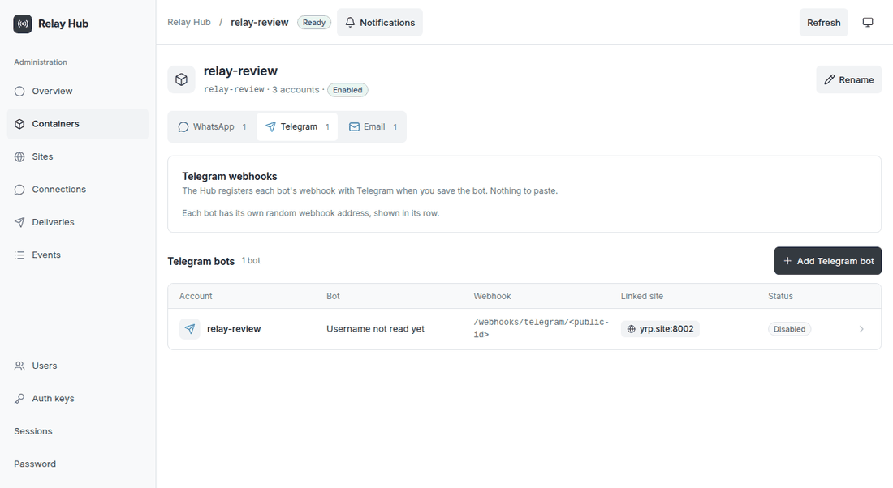

There is nothing to paste for Telegram. When you save a bot, the Hub registers the bot's webhook with Telegram by itself. Each bot has its own random webhook address, shown in its row.

**Add Telegram bot** dialog fields: **Account name**, **Bot token** (from @BotFather), **Link to site**. **Bot username** is read from the token. After **Test and add**, the Hub checks the token, reads the bot name and registers the webhook. When you edit a saved bot, the dialog also shows **Account enabled** and its own **Forward copies to** card.

#### Email tab

The Hub reads each mailbox with IMAP. If your mail provider can forward mail to a web address, you can use the mailbox's own webhook address instead.

**Add mailbox** dialog fields:

| Field | What to type |
| --- | --- |
| Account name | A name that people know. |
| Email address | The From address. Required. |
| SMTP host, Port and security | The send server. Ports: 465 (SSL), 587 (STARTTLS) or 25 (STARTTLS). |
| IMAP host, Port and folder | The receive server. Leave the host blank if you use only the webhook. Ports: 993 (SSL) or 143 (STARTTLS). Folder is `INBOX` by default. |
| Username, Password or app password | The mail login. |
| Link to site | Optional. |

After **Test and add**, the Hub tests SMTP and IMAP. The test sends no mail and reads no messages. When you edit a saved mailbox, the dialog also shows the **Inbound webhook URL** with **Copy**, **Account enabled** and a **Forward copies to** card.

> Relay Core shows only WhatsApp today. You can add Telegram bots and mailboxes in the Hub, but the Core inbox does not offer them yet.

### 4.4 Sites

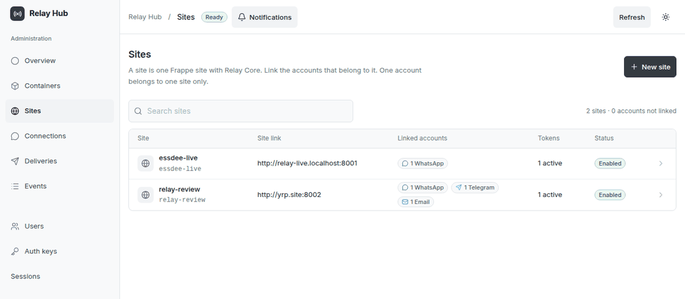

The list shows each site with its ID, its site link, its linked accounts, its active auth keys and its status. The line above the list shows how many accounts are not linked to any site.

**New site** opens this dialog:

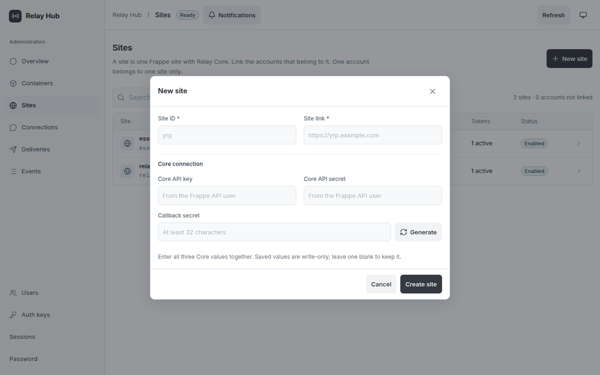

| Field | What to type | Notes |
| --- | --- | --- |
| Site ID | A short name, for example `yrp`. Letters, numbers, `-` and `_`. | You cannot change it later. Core needs the same value as "Hub account". |
| Site link | The address of the Core site, for example `https://yrp.example.com`. | No path. It must match the address that the Core site uses. |
| Core API key, Core API secret | The API key pair of the Frappe service user on that site. | See [recipe 5.4](#54-connect-a-core-site). |
| Callback secret | Click **Generate**, or type 32 or more characters. | Copy it now. You paste the same value in Core. |

You can create a site with no Core values and add them later. If you type one Core value, you must type all three. After **Create site**, the Hub opens the site page. The site shows **Setup needed** until all three Core values are saved.

#### Site page

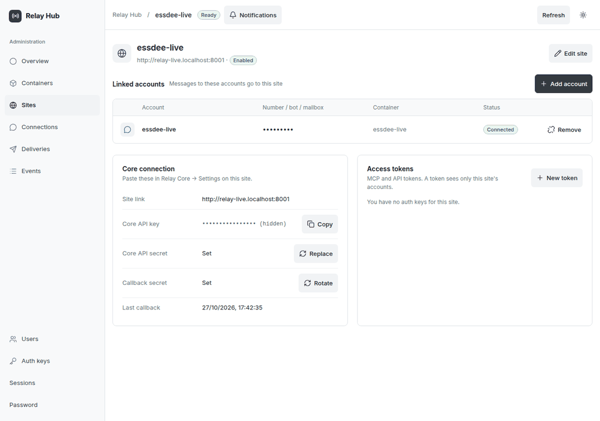

**Edit site** opens a dialog with **Site link**, **Site enabled** and the three Core values. If you clear **Site enabled**, the Hub stops giving messages to this Core site and Core can no longer use its auth keys.

**Linked accounts** shows the numbers, bots and mailboxes whose messages go to this site.

- **Add account** opens a picker. It lists every account in every container. Tick the free ones and click **Add N accounts**. From that moment, new messages to those accounts go to this site.
- An account with **Already here** is on this site. An account with **On <other site>** belongs to another site and you cannot tick it. Remove it from the other site first.
- **Remove** on a row unlinks the account after you confirm. New messages to it then stay in the Hub as unassigned. They do not reach any site. The account itself and its settings stay in its container.

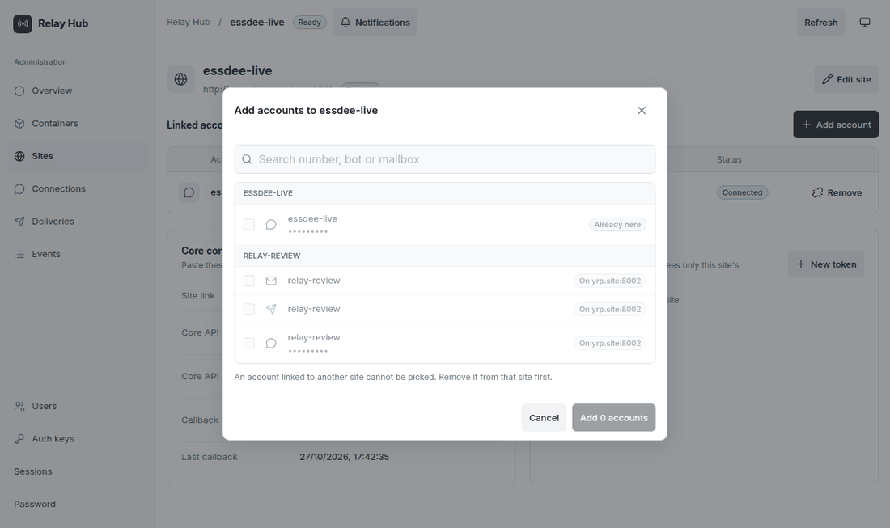

**Core connection** card:

| Row | Button | What it does |
| --- | --- | --- |
| Site link | | The address the Hub uses to reach Core. |
| Core API key | **Copy** | Copies the saved key. If no key is saved, the button is **Replace**. To change a saved key, use **Edit site**. |
| Core API secret | **Replace** | Opens a dialog for a new secret. |
| Callback secret | **Rotate** | Makes a new random secret. Click **Copy**, then **Save**. Paste the same value in Core at once. Messages to Core fail until both sides have the same value. |
| Last callback | | The last time the Hub gave a message to Core. |

**Access tokens** card lists your own auth keys for this site and their state. **New token** opens the Auth keys page.

### 4.5 Connections

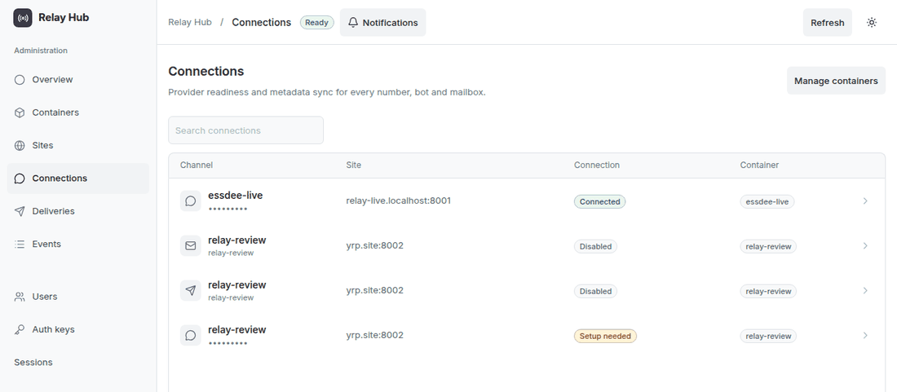

One row for each number, bot and mailbox in all containers, with its site, its status and its container. Use the search box to find one. **Manage containers** opens the Containers page.

Click a row to open its connection details:

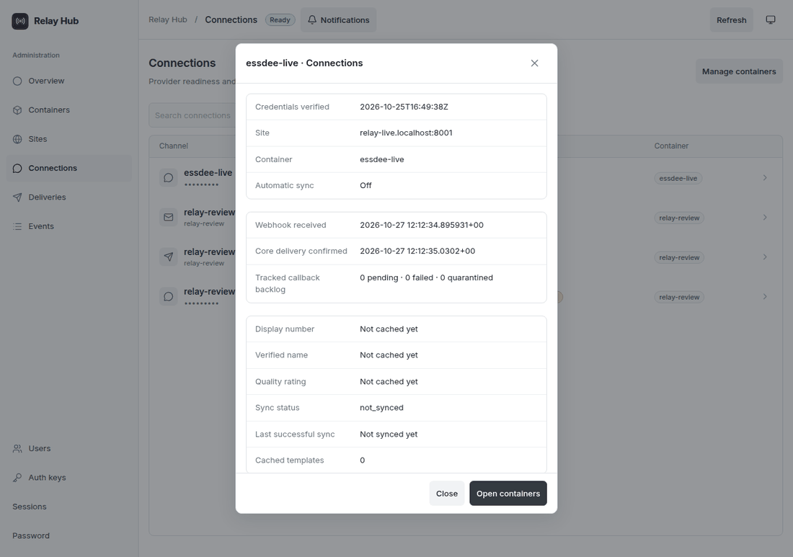

- For WhatsApp: when Meta last verified the credentials, the site, the container, hourly sync on or off, the health numbers, and the cached Meta data (display number, verified name, quality rating, cached templates, last sync).
- For Telegram: **Check webhook** shows if the webhook points to this Hub. **Register / repair webhook** registers it again.
- For Email: **Test connection** tests SMTP and IMAP. **Show ingress setup** shows the mailbox webhook address and its secret, with **Reveal secret** and **Copy secret**.
- **Refresh health** reads the health numbers again.

These checks do not change your settings, except **Register / repair webhook**, which changes the bot's webhook at Telegram.

### 4.6 Deliveries

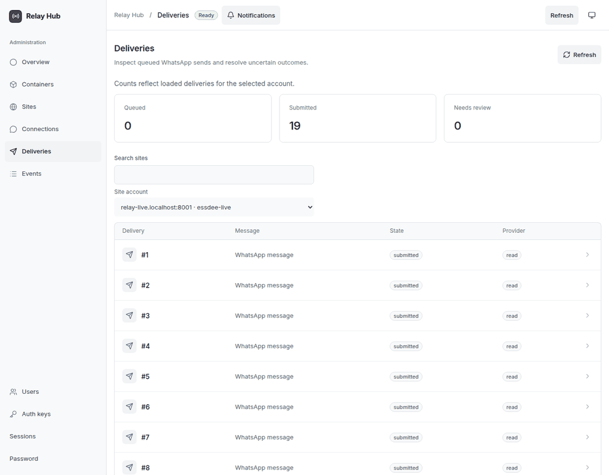

This page shows the WhatsApp sends of one account. Pick a site account first. Only accounts that are linked to a site show in the list.

- The counts show **Queued**, **Submitted** and **Needs review** for the loaded rows.
- Each row shows the delivery number, the message type, the queue state and the provider status (for example sent, delivered, read).
- Click a row to see the details. For a **queued** send you can click **Cancel queued send**, then **Confirm cancellation**. The Hub cancels only if sending has not started.
- For an **uncertain** send (the Hub does not know if Meta took it), click **Resolve outcome**. Check the result with Meta first. Choose "Provider accepted" or "Provider rejected", type the evidence (10 or more characters) and click **Record outcome**. This never sends the message again.

**Core callbacks** (lower part of the page) lists messages that the Hub could not give to Core. Click one to open **Recover Core callback**:

- **Replay callback to Core** tries to give the event to Core again. It does not send anything to the customer.
- **Quarantine callback** stops the retries for this event so that a person can look at it.
- Type the reason (10 or more characters) and click **Confirm recovery**.

### 4.7 Events

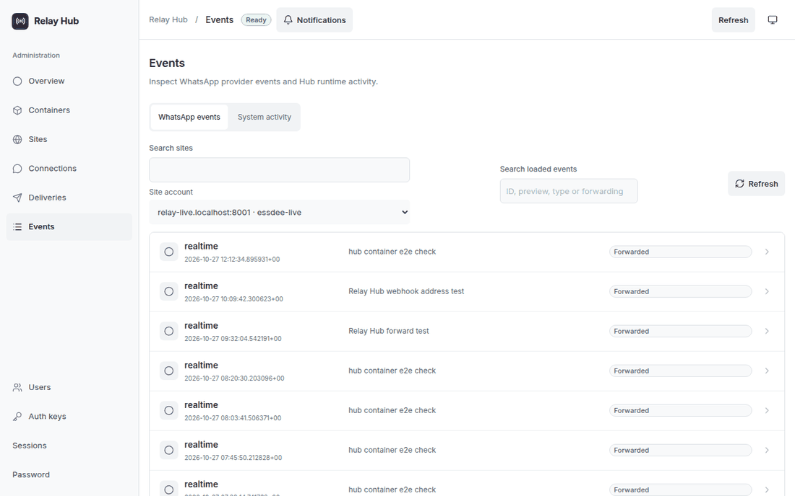

**WhatsApp events** tab: pick a site account to see the raw WhatsApp webhooks of that number, newest first. The badge shows if the event was forwarded to Core. Click a row to see the full payload. **Load older events** reads older pages. The search box searches only the loaded rows.

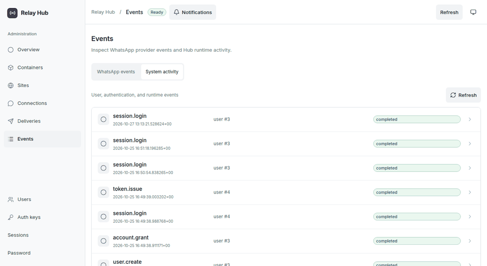

**System activity** tab: sign-ins, user changes, auth key changes and runtime events, with the outcome. Click a row for the time, site, actor and any error. This list never shows passwords or keys.

### 4.8 Users (administrators only)

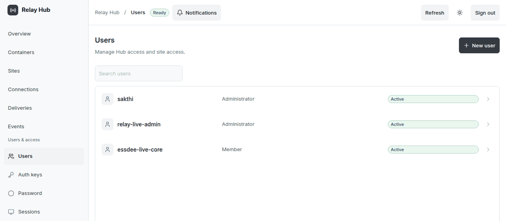

The list shows each user with the role and Active or Disabled.

**New user** fields: **Username**, **Role** (Member or Administrator), **Initial password** (14 or more characters). Give the password to the person in a safe way. They can change it on the Password page.

Click a user to open the details:

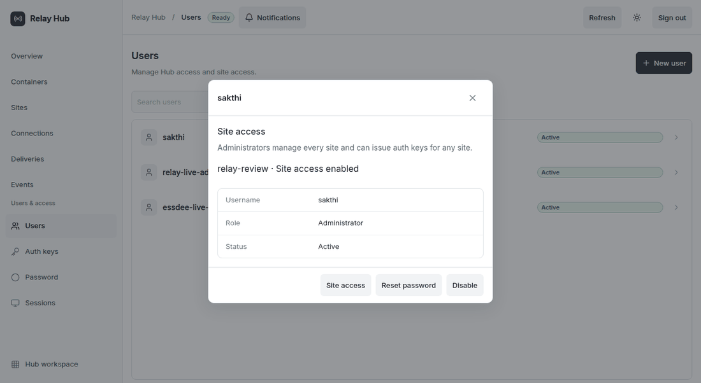

- **Site access**: pick a site and save to give the user access to it. Pick a site and click **Remove access** to take it away. Removing access also revokes that user's auth keys for that site at once.
- **Reset password**: sets a new password. It signs the user out and always revokes all their auth keys.
- **Disable**: the user cannot sign in, and all their auth keys are revoked at once. **Enable** lets them sign in again, but revoked keys do not come back.

### 4.9 Auth keys

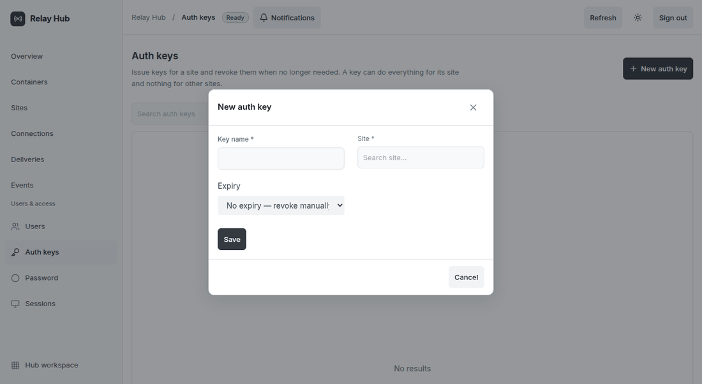

This page lists only your own auth keys. **New auth key** fields:

| Field | Meaning |
| --- | --- |
| Key name | A name that tells you where it is used, for example "yrp core". |
| Site | The site that the key works for. Administrators can pick any site. Members see only their granted sites. |
| Expiry | No expiry (revoke by hand), 30 days or 90 days. |

After **Save**, the Hub shows the key one time. Copy it and click **I copied the key**. The Hub keeps only a hash, so nobody can show the key again.

A key can do everything for its site and nothing for other sites. Click a key and **Revoke key** to stop it at once. A user can have at most 20 active keys.

Important: a key belongs to the user who made it. If that user is disabled, gets a password reset, or loses access to the site, the key stops working and Core loses its Hub connection. Make the key for a site with a user that stays active.

### 4.10 Sessions

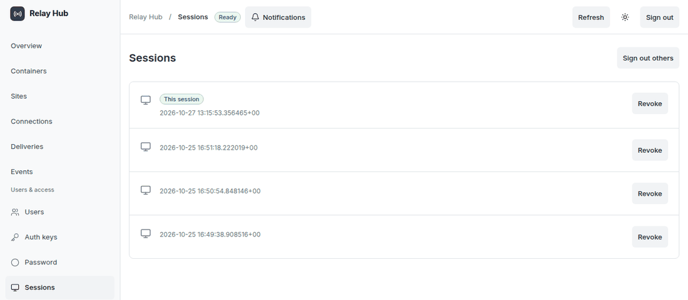

Each browser where you are signed in. **This session** marks the current browser. **Revoke** signs out one browser. **Sign out others** signs out all browsers except this one.

### 4.11 Password

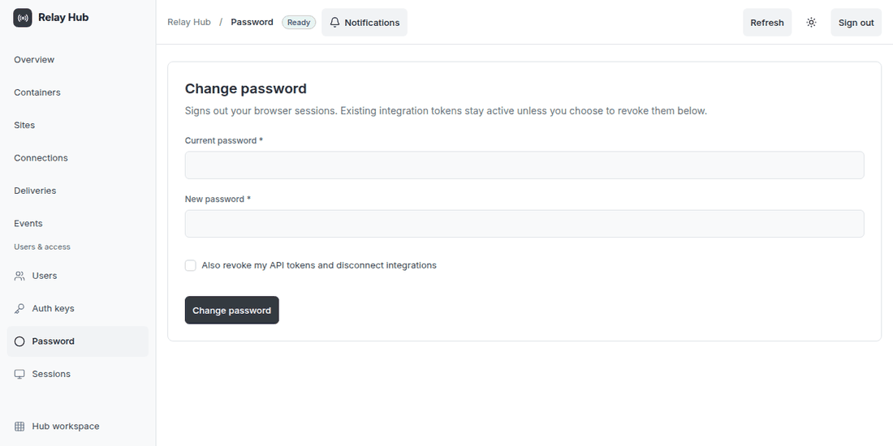

Type your current password and a new password (14 or more characters). Changing the password signs out all your browsers. Your auth keys stay active unless you tick **Also revoke my API tokens and disconnect integrations**. If you tick it, every site that uses one of your keys loses its Hub connection until you make new keys.

## 5. Recipes

### 5.1 First setup on a new server

1. Follow [deployment](deployment.md). On the server run `./relay setup`. It asks for the database, writes `.env`, builds the Hub, applies migrations and starts the service.
2. Make the first administrator with `./relay create-admin`. Keep the password safe.
3. Put an HTTPS proxy in front of the Hub. Sign in only through the HTTPS address.
4. Back up `.env` to a safe place. Without it, saved provider secrets cannot be read.
5. Sign in and check that the top bar shows **Ready**.

### 5.2 Add a WhatsApp number

Before you start, you need in Meta: a Meta app with the WhatsApp product, the number added to a WhatsApp Business Account (WABA), and a system-user access token with `whatsapp_business_messaging` and `whatsapp_business_management`.

1. In the Hub, open **Containers**. Open the container for this Meta app, or click **New container** and give it a name.
2. On the **WhatsApp** tab, click **Edit** in the **Meta app and webhook** card.
3. Type the **App ID** and the **App secret** (Meta App Dashboard → App settings → Basic). Click **Generate** for the verify token. Optionally paste the system-user token. Click **Save**. The card shows **Webhook ready**.
4. Click **Copy** next to **Callback URL**.
5. In Meta App Dashboard → WhatsApp → Configuration, paste the callback URL. Go back to the Hub, click **Copy** next to **Verify token**, and paste it in Meta. Click **Verify and save** in Meta.
6. In the same Meta page, under webhook fields, subscribe to `messages`. This field brings incoming messages and delivery and read statuses. Subscribe to `calls` only if you use calls.
7. In the Hub, click **Add WhatsApp number**. Type the account name, the Phone number ID and the WABA ID (Meta → WhatsApp → API Setup). Paste the access token or leave it blank to use the container token. Pick the site or keep "Not linked".
8. Click **Test and add**. The number now receives messages. If you picked a site, its messages go to that site.

Meta changes its menus from time to time. If a menu name is different, look for the WhatsApp "Configuration" and "API Setup" pages of your app.

### 5.3 Link a number to a site

Use one of these two ways:

- **Sites** → open the site → **Add account** → tick the number → **Add 1 account**.
- **Containers** → open the container → click the number → **Link to site** → pick the site → **Test and save**.

From that moment, new messages to the number go to that site. Messages that came while the number had no site stay in the Hub. They do not move by themselves (see [section 8](#8-things-the-hub-pages-cannot-do-yet)).

To move a number to another site, remove it from the old site first, then add it to the new site. The Hub refuses the move while the number still has sends that are not finished.

### 5.4 Connect a Core site

A Core site needs four values that go in two directions:

| Value | Made in | Pasted in |
| --- | --- | --- |
| Core API key and Core API secret | Frappe on the Core site | Hub → Sites → the site |
| Callback secret | Hub (Generate) | Hub → Sites → the site, and Core → Settings |
| Auth key | Hub → Auth keys | Core → Settings ("API token") |
| Site ID | You choose it in the Hub | Core → Settings ("Hub account") |

Steps:

1. On the Core site, open the Desk. Make a service user (for example `relay-hub@yrp.example.com`) with the role **Relay Hub Service**. Open the user → **API Access** → **Generate Keys**. Copy the API key and the API secret. Frappe shows the secret only one time.
2. In the Hub, open **Sites** → **New site**. Type the Site ID (for example `yrp`) and the Site link (the exact address of the Core site). Paste the Core API key and secret. Click **Generate** for the callback secret and copy it. Click **Create site**.
3. In the Hub, open **Auth keys** → **New auth key**. Name it, pick the site, keep "No expiry" or choose an expiry. Click **Save** and copy the key.
4. On the Core site, open Relay (`/relay`) → **Settings & Setup** → **Hub connection**. Type:
   - **Hub MCP URL**: the Hub address followed by `/mcp`, for example `https://hub.example.com/mcp`.
   - **Hub account**: the Site ID, for example `yrp`.
   - **Replace API token**: the auth key from step 3.
   - **Replace callback signing secret**: the callback secret from step 2.
5. Click **Save connection** in Core. Core asks the Hub which site the key belongs to. If the site ID or the site link do not match, Core shows "Hub account does not match this Frappe site".
6. Link the numbers to the site ([recipe 5.3](#53-link-a-number-to-a-site)). Send a test message to the number. In the Hub, **Overview** must show a new "Webhook received" and a new "Core delivery confirmed".

### 5.5 Templates

You manage WhatsApp templates in Core, not in the Hub. In Core open Relay → **WhatsApp** → **Templates**. When you create, edit or delete a template there, Core asks the Hub, and the Hub sends the request to Meta. Meta must approve a new template before you can send it.

Core reads the template list from the Hub every 10 minutes. The Hub keeps a copy per WABA and marks it old after each change, so the next read gets the new list.

The **Templates** switch must be on for the number in the Hub. A new number starts with it on. To change it, open the number in its container.

### 5.6 Add a forward target

Use this when an old system must also get the WhatsApp, Telegram or email webhooks.

1. For WhatsApp: open the container → **WhatsApp** tab → **Forward copies to**. For a Telegram bot or a mailbox: open that account's dialog.
2. Type the URL and click **Add URL**. Use `https`. `http` is allowed only for local, private and Tailscale addresses. You can add up to 5 targets.
3. From now on, each webhook that passed the Hub's check is also sent to that URL, with the same body and signature headers. The Hub answers the provider first, then sends the copy.
4. The card shows delivered, waiting and failed counts, and a table of results. The Hub tries each copy up to 3 times and keeps the results for 7 days.

**Remove** stops the copies to that URL and deletes its results. Forwarding never changes what the Hub itself does with the message.

### 5.7 Billing

The Hub has no billing page. Billing is in Core: Relay → **WhatsApp** → **Billing**. Core reads the monthly Meta charges through the Hub once a day. In Core → **Settings & Setup** you can set a **Service charge (%)** that Core adds to the rate per message.

### 5.8 Add a user

1. Open **Users** → **New user**.
2. Type a username, pick **Member** or **Administrator**, and type an initial password of 14 or more characters. Click **Save**.
3. For a member, click the user → **Site access** → pick the site → save. Repeat for each site.
4. Give the username and password to the person in a safe way. Ask them to change the password on the **Password** page.

### 5.9 Rotate a key or secret

| What | Steps | Break while you work |
| --- | --- | --- |
| Auth key | Hub → **Auth keys** → **New auth key** for the same site. Paste it in Core → Settings → **Replace API token** → **Save connection**. Then revoke the old key in the Hub. | None, if you revoke the old key last. |
| Callback secret | Hub → site → **Rotate** → **Copy** → **Save**. At once paste it in Core → Settings → **Replace callback signing secret** → **Save connection**. | Messages to Core fail between the two saves. The Hub retries them. |
| Core API key and secret | In Frappe, generate new keys for the service user. In the Hub, site → **Edit site**, paste the new key and secret, **Save**. | Messages to Core fail between the two steps. The Hub retries them. |
| Meta app secret | Reset it in Meta. Paste the new value in Hub → container → **Edit** → **App secret** → **Save**. | WhatsApp webhooks are refused between the two steps. Meta retries them for a time. |
| WhatsApp access token | Paste the new token in the number's dialog (or the container's system-user token) and save. | Sends fail with the old token after Meta revokes it. |
| Telegram bot token | Paste the new token in the bot's dialog and click **Test and save**. | The Hub registers the webhook again. |

### 5.10 Check health and logs

1. Look at the **Ready** badge in the top bar. Open **Notifications** for the last error.
2. Open **Overview**. For each site, check "Webhook received" (the provider reaches the Hub) and "Core delivery confirmed" (Core takes the messages). Check the callback backlog: pending, failed and quarantined.
3. Open **Connections** and click an account for its details and checks.
4. Open **Deliveries** for stuck or uncertain sends and for failed Core callbacks.
5. Open **Events** → **System activity** for sign-ins and changes.
6. On the server: `./relay status` shows the service state and readiness. `./relay logs` follows the log. See [deployment](deployment.md#troubleshooting).

### 5.11 Common errors and fixes

| You see | Cause | Fix |
| --- | --- | --- |
| Container shows **Setup needed** | The app secret or the verify token is missing. | Container → **Edit**, add both, **Save**. |
| Meta says the callback URL could not be verified | The verify token in Meta is different from the Hub, or the URL is wrong, or the Hub is not reachable over HTTPS. | Copy both values again from the container page. Check the HTTPS proxy. |
| Number shows **Idle** | The number is not linked to a site. | [Recipe 5.3](#53-link-a-number-to-a-site). |
| Number shows **Setup needed** or **Failed** | The number was not verified with Meta, or the test failed. | Open the number, check Phone number ID, WABA ID and the token, click **Test and save**. |
| Site shows **Setup needed** | One of the three Core values is missing. | Site → **Edit site**, add the missing value. |
| "Saved. The connection test failed: …" | The values are saved, but the provider refused them. | Read the message, fix the value, save again. |
| "Saved, but linking to the site failed: …" | The number still has unfinished sends for its old site. | Wait until Deliveries shows no queued or uncertain sends for it, then link again. |
| Core: "Hub account does not match this Frappe site" | The Hub account in Core is not the Site ID, or the Hub site link is not the Core site's own address, or the auth key is for another site. | Make the three values match. |
| "Webhook received" is new but "Core delivery confirmed" is old | Core does not take messages: wrong Core API key or secret, wrong callback secret, or Core is down. | Check the site's Core values and the callback secret on both sides. Then use **Deliveries** → **Core callbacks** → **Replay**. |
| Telegram check says "Registered elsewhere" and asks for a repair | Another system set the bot's webhook. | **Connections** → the bot → **Register / repair webhook**. |
| Auth keys: "revoke an existing token first" | You have 20 active keys. | Revoke a key that is not used. |
| Users: "cannot disable the last administrator" | The Hub must keep one active administrator. | Make another administrator first. |
| The sign-in page comes back after you sign in | You use an HTTP address or the proxy changes the host. | Use the HTTPS address of the Hub. |

## 6. Status labels

| Where | Label | Meaning |
| --- | --- | --- |
| Container | Enabled / Disabled | Disabled stops all its accounts. |
| Container WhatsApp card | Webhook ready / Setup needed | App secret and verify token saved, or not. |
| Account | Disabled | The account is off. |
| Account | Idle | The account is on but has no site. Its messages stay in the Hub. |
| WhatsApp account | Connected / Failed / Setup needed | Meta check passed, failed, or not done. |
| Telegram account | Registered / Not checked | The webhook is registered at Telegram, or not checked yet. |
| Email account | Connected / Mail error / Not checked | SMTP and IMAP test result. |
| Site | Enabled / Setup needed / Disabled | All three Core values saved, one missing, or the site is off. |
| Auth key | Active / Expired / Revoked | The key works, passed its expiry date, or was stopped. |
| Delivery | queued / submitted / uncertain | Waits to send, Meta took it, or the result is unknown and needs a check. |
| Core callback | Retrying / Quarantined | The Hub still tries to give it to Core, or it waits for a person. |

## 7. What happens if…

**…I add a number but do not link it to a site?** The number receives messages and the Hub keeps them. It answers Meta with success. No message reaches Core.

**…I remove a number from a site?** New messages stay in the Hub as unassigned. Old messages in Core stay in Core. The number and its settings stay in the container.

**…I link a number that was unlinked for some days?** New messages go to the site from that moment. The messages that came while it was unlinked do not move by themselves. An operator can replay them (see section 8).

**…I disable a container?** All numbers, bots and mailboxes in it stop receiving and sending. Settings stay. Enable it again to restart.

**…I disable one account?** Only that account stops. The others in the container keep working.

**…I disable a site?** The Hub stops giving messages to that Core site, and Core cannot use its auth keys. Enable it again to restart.

**…I change the site link?** The Hub sends messages to the new address. If the new address is not the Core site's own address, Core refuses the connection check.

**…I rotate the callback secret in the Hub only?** Core refuses every message from the Hub until you paste the same secret in Core. The Hub keeps and retries them.

**…I type a wrong app secret?** The Hub refuses all WhatsApp webhooks of that container, because the signatures do not match. Meta retries for a time. Fix the secret quickly.

**…I change the verify token?** Messages keep coming. Meta uses the verify token only when you click **Verify and save** in Meta. Use the new value the next time you verify.

**…I revoke an auth key that Core uses?** Core cannot send messages or read templates through the Hub until you paste a new key in Core.

**…I disable a user or reset their password?** All their auth keys stop at once. Any Core site that uses one of their keys loses its Hub connection.

**…I remove a forward target?** The Hub stops sending copies to it and deletes its results. The Hub itself keeps working as before.

**…I add the same number to two sites?** You cannot. One account belongs to one site. The picker does not let you tick an account that is on another site.

**…I delete a container, a number or a site?** The Hub pages have no delete button. Disable it instead.

## 8. Things the Hub pages cannot do yet

These tasks need an operator with the admin API in the [API reference](api-reference.md#administration-routes):

- **Replay unassigned messages.** Messages that came while a number had no site stay in the Hub. `POST /api/unassigned-events/replay` gives them to the number's current site.
- **Delete** containers, accounts or sites.
- **Change a Site ID** or a channel key.
